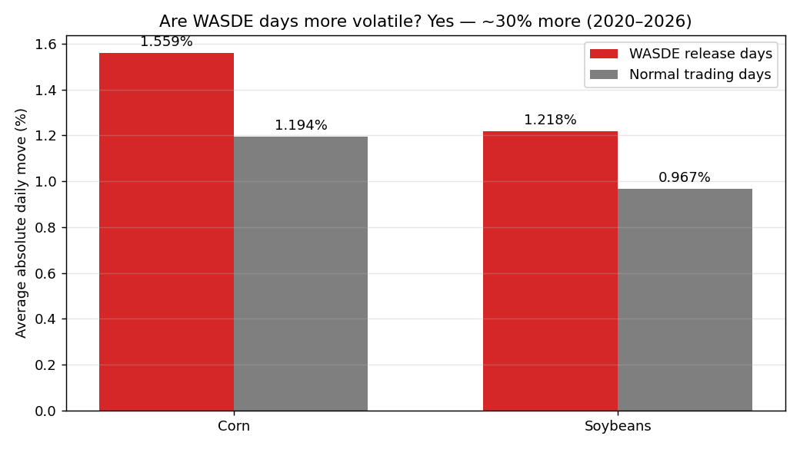
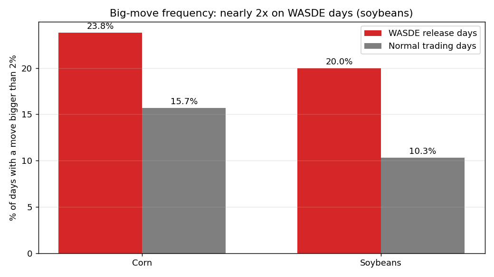

# WASDE Report-Day Study — Do Prices Actually Jump on Report Days?

The USDA's monthly WASDE (World Agricultural Supply and Demand Estimates)
report is the most-watched scheduled event in grain markets. This project
tests the folk wisdom with data: **80 WASDE releases (Jan 2020 → Sep 2026)**
against **8,400+ trading days** of CBOT corn and soybean futures.

## The answer: yes, clearly

| | Corn | Soybeans |
|---|---|---|
| Avg daily move, WASDE days | **1.56%** | **1.22%** |
| Avg daily move, normal days | 1.19% | 0.97% |
| WASDE vs normal | **1.31x** | **1.26x** |
| Days with >2% moves, WASDE days | **23.8%** | **20.0%** |
| Days with >2% moves, normal days | 15.7% | 10.3% |

WASDE days run ~30% hotter than ordinary days, and a >2% swing is roughly
twice as likely on soybeans when the report drops.




Biggest single report-day reactions: corn +6.3% (Jul 2021 WASDE) and −6.2%
(Jul 2022 WASDE) — July reports move markets because that's when US crop
weather decides the harvest.

## Queries

| Query | Question |
|---|---|
| `01_report_day_vs_normal` | Headline comparison: avg move and big-move frequency |
| `02_biggest_report_day_moves` | The 15 most violent report-day reactions |
| `03_wasde_effect_by_year` | Is the effect stable year to year? |

## How to run it

```bash
python3 load_wasde.py   # builds data/wasde.db from the dates CSV + futures prices
sqlite3 data/wasde.db < queries/01_report_day_vs_normal.sql
```

## Data sources

- WASDE release dates: USDA WASDE archive (80 dates, 2020-01-10 → 2026-09-11;
  note the archive shows no October 2025 release)
- Futures prices: companion
  [corn-soy-futures-sql](https://github.com/josea12345/corn-soy-futures-sql)
  project (CBOT `ZC=F` / `ZS=F` via Yahoo Finance)

WASDE drops at 12:00 ET, mid-session, so each release day's close captures
the market reaction.

## Skills demonstrated

SQL (window functions, conditional aggregation) · Python (data wrangling,
SQLite) · event-study methodology · agricultural market knowledge
